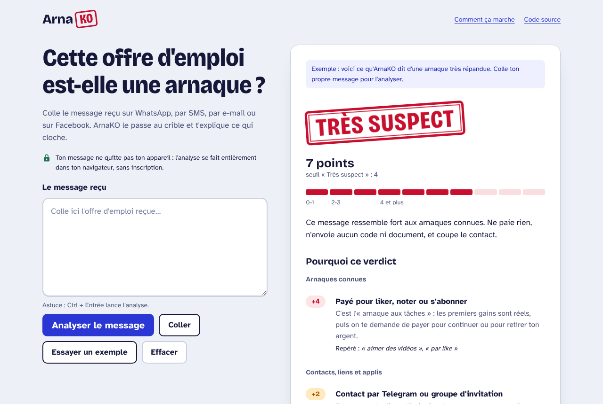

# ArnaKO

**Mets K.O. les arnaques à l'emploi.**

ArnaKO est un site gratuit qui vérifie les offres d'emploi reçues sur WhatsApp, par SMS, par e-mail ou sur Facebook. On colle le message, ArnaKO repère les signes d'arnaque, donne un verdict et explique pourquoi.

**Site en ligne : https://cyberachille.github.io/arnako/**



## Ce que fait ArnaKO

- **Un verdict en trois niveaux** : Rien d'alarmant, Prudence ou Très suspect.
- **Les raisons du verdict** : chaque signal trouvé est affiché avec son explication et le passage exact qui l'a déclenché.
- **Le message surligné** : les passages suspects apparaissent en couleur selon leur gravité.
- **Quoi faire ensuite**, et une marche à suivre si l'on a déjà payé ou donné un code.
- **Un résultat à partager** : un bouton copie le verdict pour prévenir un proche sur WhatsApp.

## Confidentialité

L'analyse se fait **entièrement dans le navigateur**. Aucun message n'est envoyé nulle part : pas de serveur, pas de base de données, pas de cookie, pas de traceur, pas de police chargée depuis Google.

La page impose une politique de sécurité (CSP) qui interdit toute connexion sortante (`connect-src 'none'`). Le texte collé est affiché avec `textContent`, jamais avec `innerHTML`, donc aucune injection de code n'est possible.

## Comment ArnaKO décide

ArnaKO cherche **55 signaux d'alerte** répartis en 7 familles. Chaque signal vaut de 1 à 5 points.

| Score | Verdict |
|---|---|
| 0 ou 1 | Rien d'alarmant |
| 2 ou 3 | Prudence |
| 4 et plus | Très suspect |

Les indices faibles (+1 : une adresse Gmail, « urgent », un contact WhatsApp…) comptent **au maximum pour 2 points**. Une vraie offre togolaise écrite simplement ne sort donc jamais en rouge pour ces seules raisons.

| Famille | Signaux | Exemples |
|---|---|---|
| Argent demandé | 8 | frais de dossier, paiement Flooz / T-Money / Western Union, cartes cadeaux, « recharge » pour débloquer des gains, faux chèque, mule financière |
| Codes et données sensibles | 9 | code reçu par SMS, mot de passe, numéro de carte et CVV, selfie avec pièce d'identité, portefeuille crypto |
| Contacts, liens et applis | 10 | appli ou fichier .apk à installer, AnyDesk / TeamViewer, lien raccourci, adresse douteuse, Telegram, « recrutement.entreprise@gmail.com » |
| Promesses trop belles | 8 | gros salaire à domicile, argent sans expérience, paiement chaque jour, embauche sans entretien |
| Pression et secret | 7 | urgence, délai de 24 h, « ne le dis à personne », « discrétion exigée », « réponds OUI » |
| Arnaques connues | 11 | arnaque aux tâches (liker, noter), réexpédition de colis, pyramide, faux emploi à l'étranger, loterie, hameçonnage |
| Forme du message | 2 | MAJUSCULES et « !!! », émojis d'argent |

### Ce qu'ArnaKO sait déjouer

- **Les camouflages** : accents, MAJUSCULES, `fr@is`, `inscript1on`, `W h a t s A p p`, `t.e.l.e.g.r.a.m`, polices fantaisie (𝐔𝐑𝐆𝐄𝐍𝐓) et caractères invisibles glissés entre les lettres.
- **Les négations** : « Aucun frais de dossier n'est demandé » ou « Ne partagez jamais votre code » ne déclenchent pas d'alerte.
- **Les montants** : il lit 300 €/jour, 600k/mois, 50 000 F la semaine ou $5,000 per week, et ramène tout au mois. Un salaire annuel classique n'est pas jugé suspect.
- **Les langues** : il comprend le français et l'anglais, et connaît le contexte togolais (Flooz, T-Money, Mixx by Yas, Moov Money, FCFA).

## Fiabilité : les vrais chiffres

ArnaKO a été mis au point et testé sur **342 messages réalistes** (175 arnaques, 167 vraies offres), écrits en 5 lots. Les lots 3, 4 et 5 ont chacun été passés **une seule fois, à l'aveugle**, avant toute correction. C'est cette mesure qui compte.

| Test à l'aveugle | Arnaques signalées | dont « Très suspect » | Vraies offres classées « Très suspect » |
|---|---|---|---|
| Lot 3 (80 messages) | 34 / 40 | 29 / 40 | 2 / 40 |
| Lot 4 (60 messages) | 20 / 30 | 16 / 30 | 0 / 30 |
| Lot 5 (40 messages), version finale | **18 / 20** | 14 / 20 | **0 / 20** |

Après chaque lot, les règles ont été élargies de façon générale (pas recopiées sur les messages ratés). Sur l'ensemble des 342 messages, la version actuelle signale 174 arnaques sur 175 et ne classe qu'une vraie offre « Très suspect » : une formation payante, ce qui mérite un avertissement.

Ces derniers chiffres sont flatteurs, car le moteur a été réglé sur ces messages. **Pour des messages vraiment nouveaux, compte plutôt sur 7 à 9 arnaques sur 10 signalées, selon leur style.** Une arnaque bien écrite peut passer à travers. Lance `npm run evaluer` pour voir le détail.

**Un verdict vert ne garantit rien.** Une règle ne souffre aucune exception : on ne paie jamais pour obtenir un emploi.

## Déploiement

Le site est publié par **GitHub Pages** depuis la branche `main` (dossier racine) : chaque `git push` met le site à jour en une à deux minutes. Les tests se lancent automatiquement à chaque envoi (onglet **Actions**).

### Déployer ta propre copie

1. Fais un **fork** de ce dépôt.
2. Remplace le pseudo dans les liens :
   ```bash
   grep -rl CyberAchille . | xargs sed -i 's/CyberAchille/ton-pseudo/g'
   ```
3. Sur GitHub : **Settings → Pages → Build and deployment**, choisis **Deploy from a branch**, branche `main`, dossier `/ (root)`, puis **Save**.

## Lancer en local

Ouvre simplement `index.html` dans ton navigateur. Tu peux aussi lancer un petit serveur :

```bash
npm start            # ou : python3 -m http.server 8000
```

puis ouvrir http://localhost:8000.

## Tests

```bash
npm test             # 13 tests automatiques (règles, camouflages, négations, performance, non-régression)
npm run evaluer      # mesure détaillée sur les 342 messages du banc d'essai
```

## Améliorer ArnaKO

Le meilleur moyen de le rendre plus fiable, ce sont de **vrais messages**. Sur le site, le lien « Signaler un message mal analysé » ouvre un formulaire GitHub. Retire toujours tes informations personnelles avant de partager un message.

Pour ajouter une règle, ouvre `js/detecteur.js`, section « 5. Les règles » :

```js
{
  id: "mon_signal",
  categorie: "argent",            // argent, secrets, contact, promesses, pression, schemas, forme
  points: 3,                      // 1 = indice faible … 5 = très grave
  libelle: "Ce que l'utilisateur verra",
  explication: "Pourquoi c'est un signal d'alerte, en une phrase.",
  motifs: [ R(String.raw`\bmon motif\b`) ],   // appliqué au texte en minuscules, sans accents
},
```

Ajoute ensuite le message dans `tests/corpus.js`, puis lance `npm test` et `npm run evaluer` pour vérifier que rien d'autre n'a bougé.

## Structure du dépôt

```
index.html                  la page
css/style.css               la mise en forme
js/detecteur.js             le moteur : normalisation, 55 règles, score (fonctionne aussi dans Node)
js/app.js                   l'interface
fonts/                      polices embarquées (licence SIL OFL)
tests/corpus.js             le banc d'essai : 342 messages
tests/detecteur.test.js     les tests automatiques
tests/evaluer.js            la mesure de fiabilité
.github/                    tests automatiques (Actions) et formulaire de signalement
```

## Crédits

- L'idée est née du **mini-projet du week-end de Codeurs Pro** : un détecteur de fausses offres d'emploi à base de signaux et de points.
- Polices : [Bricolage Grotesque](https://github.com/ateliertriay/bricolage) et [Atkinson Hyperlegible](https://www.brailleinstitute.org/freefont/), sous licence SIL Open Font License.
- Contacts d'urgence au Togo : [CERT.tg](https://cert.tg/), d'après ses alertes publiques.

## Licence

[MIT](LICENSE). Tu peux réutiliser, modifier et partager ArnaKO librement.
